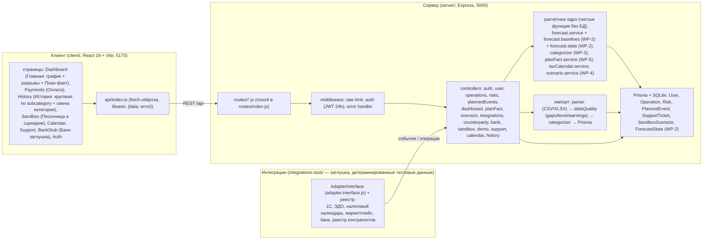

# Архитектура проекта «Cashflow Gap»

Стек: React 19 + Vite (порт 5173) / Node + Express + Prisma + SQLite (порт 5000).
Единый запуск: `npm run setup` (создаёт `server/.env` с генерируемым JWT_SECRET, ставит зависимости, `prisma db push` + сид) → `npm run dev` — сервер и клиент одновременно (`concurrently`); порты: сервер 5000, клиент 5173.

## 1. Схема компонентов

Четыре потока данных:
1. **Импорт** — файл → `POST /api/operations/import` → parser → dataQuality → categorizer (subcategory + confidence) → Prisma (транзакция, разбор до записи).
2. **Прогноз** — операции + плановые события → `calculateForecast` (детерминированный MC-бутстрап, плановые обязательства, налоговый календарь) → `GET /api/dashboard` (график, вероятные разрывы, сценарии) и `GET /api/calendar`.
3. **План-факт** — фактические операции + план (planned-events) → `planFact.service` → `GET /api/dashboard/plan-fact` (карточка-сводка на Главной + вкладка, отклонения по месяцам).
4. **Сценарий «что если»** — параметры в `Sandbox.tsx` (создание разрыва, поздний платёж клиента, рост постоянных расходов) → `scenario.service` (оверлей событий на базе квантильных расчётов) → `POST /api/sandbox/simulate` → базовый и сценарный прогноз на одном графике.

## 2. Клиент (client/src)

| Модуль | Назначение |
|---|---|
| `pages/` | Экраны: Dashboard (Главная: прогноз, вероятные разрывы, сценарии + карточка «План-факт»), OperationDetails (изменение категории операции, WP-3), Payments (Оплата), History (История: круговая диаграмма по subcategory, фильтр, список операций), Sandbox (Песочница и сценарии: создание разрыва, поздний платёж клиента, рост постоянных расходов), Calendar, Support, BankStub (Банк-заглушка), Auth (вход/регистрация) |
| `components/charts/` | `CashflowChart` (история+прогноз, интерактивные сценарии), `CashflowGapsChart` (остаток по дням с критическими зонами), `CategoryPie` (фиксированная цветовая привязка категорий — `CATEGORY_COLORS`, WP-3), `GapWarning` |
| `components/panels/` | `IntegrationsPanel` (мульти-выбор, персистентный статус «Синхронизировано» в localStorage, unsync), `PlanFactCard` (WP-5) |
| `lib/` | `cashflow` (утилиты остатка/разрывов), `format` (деньги, даты), `theme` |
| `api/index.ts` | Единая fetch-обёртка: JSON-ответы `{data, error:{code,message}}`, Bearer-токен, `http.del` и т. п. |

Правила проекта: без сторонних UI-китов, палитра «In Color Balance» (slate/emerald, rose только для danger), все подписи/сообщения на русском, деньги — `format` без ₽-иконки, время местное.

## 3. Сервер (server/src)

Цепочка `routes/*.js → middleware (rate limit, auth, error handler) → controllers → services`
описана в основной схеме (раздел 1); полный список и тела ответов — в `docs/api-contract.md`.

### Прогноз (services/forecast.service.js) — сердце системы

Детерминированная функция `calculateForecast(operations, plannedEvents, options)` без БД и LLM:

1. **Базовый остаток** — bootstrap или усечённое N(μ, σ) с сохранением среднего (`preserveMean`); блоки по 7 дней (mcBootstrapBlockDays), <56 дней истории — откат на нормальное распределение; фиксированный seed (воспроизводимость), 1000 прогонов → p10/p90 полосы.
2. **Регулярные платежи** — группировка по `normalizePurpose` (ключ без месяца, без НДС-хвоста, без номеров), окно 6 месяцев, допуск ±3 дня, медиана последних 3 повторений; сдвиг с выходных на понедельник; без повторения >45 дней — не проецируется.
3. **Сезонность** — мультипликаторы по дням месяца/недели на потоках.
4. **Налоговый календарь** (taxCalendar.service) — регулярные налоговые обязательства в будущее.
5. **Плановые события** (paid/pending PlannedEvent, займы self_loan/bank_loan) — прямые начисления.
6. **Разрывы** — первый день, где медиана/вероятность(остаток < T) ≥ 50% + «вероятный разрыв» по `probableGapThresholdPct`; пороги T=0 / T=P5 / T=P10 / T=P25 (квантилы расходов).
7. **Сценарии** — оверлей события из `buildScenarioEvents` поверх базового прогноза (в WP-4 появятся именованные `options.scenarios`).

Точка расширения для ML (см. `TZ_dorabotka_cashflow_gap.md` §4): замена внутреннего блока «2» внешним предиктором — сигнатура `calculateForecast` и контракт клиента не меняются.

### Интеграции (stub)

`integrations-stub/` — реестр провайдеров и адаптеры за AdapterInterface (sync, pull); сейчас mock (banks, tax-calendar и др.). Реальные внешние адаптеры подключаются с тем же интерфейсом без изменений контроллера: `POST /api/integrations/:provider/sync`, `DELETE .../sync` (unsync: только pending-события этого источника).

## 4. API (кратко)

| Ресурс | Методы | Замечание |
|---|---|---|
| `/auth` | register, login, me; PATCH /auth/user | JWT 24h, 401 INVALID_CREDENTIALS (WP-6) |
| `/user` | GET, PATCH | настройки (minBalance, loanRatePct, currency) |
| `/operations` | GET, POST, PATCH, DELETE, POST /import (WP-7) | импорт: разбор до записи, транзакция, dataQuality; маскирование контрагентов в ответах (WP-6) |
| `/risks`, `/planned-events`, `/support`, `/gap/self-loans` | CRUD | владение {id, userId} → чужой = 404 (WP-6) |
| `/dashboard` | GET, GET /plan-fact (WP-5) | порядок: сверка (WP-5) → события → прогноз; план-факт отклонения по месяцам |
| `/integrations` | POST/DELETE :provider/sync, GET /counterparty | провайдеры: 1C, ЭДО, налоговый календарь, маркетплейс, банк, реестр контрагентов (заглушки, WP-6) |
| `/counterparty` | GET | проверка контрагента по name/inn (WP-6) |
| `/sandbox` | POST /simulate (WP-4), POST /reset | 4 сценария «что если»: разрыв, поздний платёж, рост постоянных расходов |
| `/calendar`, `/history`, `/bank`, `/demo`, `/categories` | GET/POST | WP-5/WP-7: события календаря, срез истории, банк-заглушка, демо-выписки, таксономия (WP-3) |

Ошибки: `4xx { error: { code, message } }`, коды: VALIDATION, UNAUTHORIZED, FORBIDDEN, NOT_FOUND, RATE_LIMITED, INTERNAL (WP-6), лимитеры: 10/мин auth, 300/мин /api.

## 5. Данные и качество (WP-7)

Импорт выписки: CSV (разделитель `;`/`,` авто, BOM, кавычки, пустая строка «без движения» — НЕ пропуск) или XLSX (заголовок в первой непустой строке, поиск по алфавиту/числу/датe) → `dataQuality.js`: gaps/level/warnings (пропуски 3–7 дней — moderate, ≥8 — high) + `asOf.js`: граница 3–4 дня (полный день ≤ N-4 → asOf = день загрузки; иначе N-3). Пропущенные дни исключаются из статистики и bootstrap-пула. Ответы импорта и операций несут `dataQuality` и `import` (loaded/missing/warnings).

Демо-данные: `test-data/demo/` (3 выписки разных видов бизнеса; выбор — `server/scripts/pick-demo.mjs`,
загрузка в учётку — `POST /api/demo`, WP-7; ТЗ-доработка п.13), кнопка «Использовать демо-данные» в пустом состоянии.

## 6. Развёртывание

- VPS Ubuntu: `/opt/cashflow` — клиент собран (`client/dist`), бэкенд под PM2 (имя `cashflow`), Nginx: порт 80 → статика + прокси `/api` → `127.0.0.1:5000`; UFW открыт только 22/80; порт 5000 закрыт наружу.
- База: `server/prisma/dev.db` (SQLite); демо-вход `demo@cashflow.ru` / `demo1234` (сид, контракт docs/api-contract.md; `FORECAST_AS_OF` в server/.env применяется только к этой демо-учётке, ТЗ-доработка §9).
- Локально: `npm run dev` (5000 + 5173), `npm test` (vitest, server), `npm run lint`, `npm run build`.

## 7. Контракт и проверки

- Источники правды: `docs/api-contract.md` (контракт API), `docs/internal/TZ_cashflow_gap_app.md` (основное ТЗ), `TZ_dorabotka_cashflow_gap.md` (доработка, WP-1..WP-9), `docs/internal/TZ_addendum.md` (добавление к ТЗ).
- Машинная сверка клиент↔сервер: `check-contract.mjs` + `contract.test.js` (WP-9), тесты сервера `server/tests/` (в т.ч. security.test, logger.test, scenarios.test, planFact.test, backtest.metrics.test — по мере закрытия WP).
